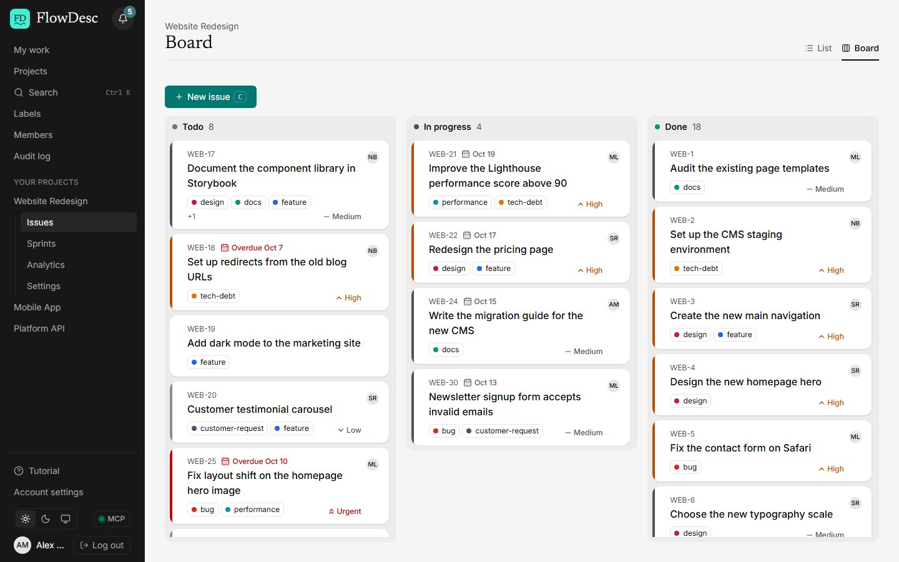
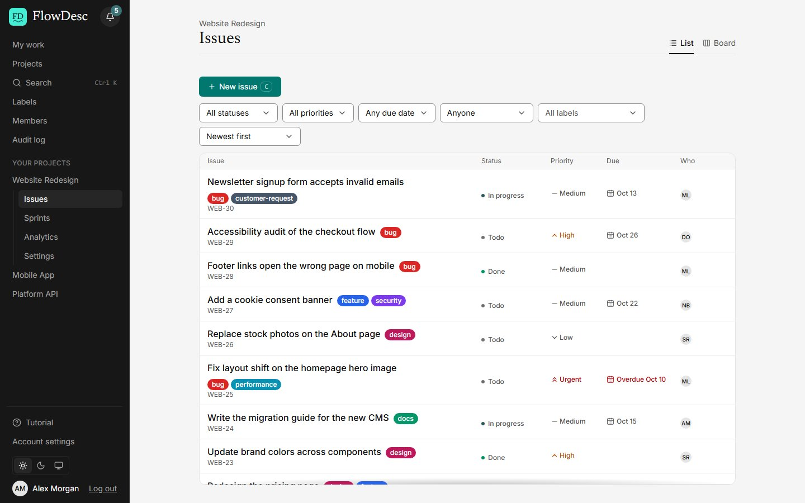
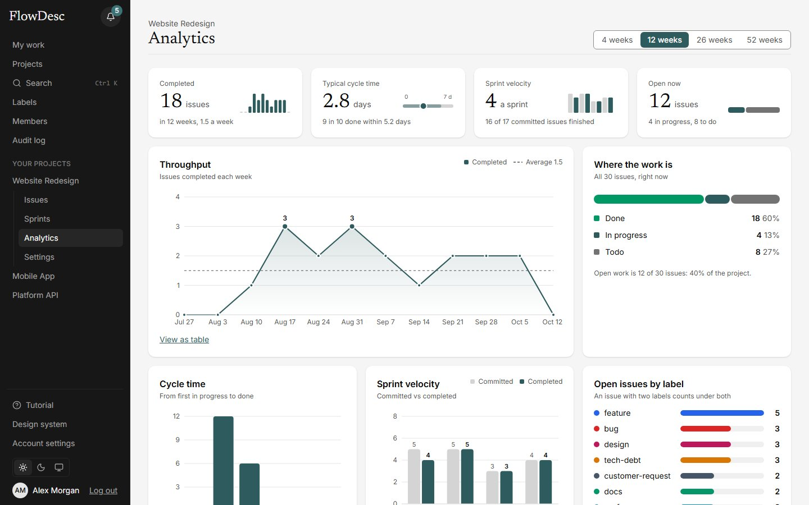

# FlowDesc

A collaborative project-management app for small engineering teams: organizations, projects, issues, a board, sprints, comments, notifications and analytics. It is built as a real product, not a demo of one, and as a learning project: every architectural decision is written down as a short record (see [Decisions](#decisions)).

**Live: <https://flowdesc.app>** (click "Try the demo" for a private copy with sample data, deleted after about two hours). **AI:** [`flowdesc-mcp` on npm](https://www.npmjs.com/package/flowdesc-mcp), an MCP server for Claude and other AI apps (see [Use it from an AI app](#use-it-from-an-ai-app-mcp)).



## Highlights

- **Real time:** the board and comments update live over WebSockets, and every edit carries a version, so two people never silently overwrite each other.
- **Analytics from an append-only event log.** Measured at 20,000 issues: sprint velocity went from 3.9 s to about 19 ms (a query-planner fix), and deleting a project from 9 s to 0.6 s (a missing index).
- **Multi-tenant isolation in two layers:** the middleware checks membership, and every query that reads tenant data filters by organization, with tests that try to cross organizations.
- **An MCP server on npm** (`flowdesc-mcp`, published from GitHub Actions with provenance): AI apps can read projects and issues and, with a token made for it, create, update and comment, one issue at a time. Read-only by default, tokens are hashed and revocable, and every change an AI makes is marked "via token".
- **More than 740 unit and API tests and more than 280 browser tests**, run on GitHub in four parallel shards.

The live site runs on free hosting, so a few things are different from a paid product (see [What to know](#what-to-know-about-the-live-site)).

## What it does

- **Work:** projects with readable keys (`/projects/WEB/issues/WEB-12`), issues with status, priority, assignee, labels and due dates; a drag-and-drop board and a sprint planner (planned, active, completed) with a sortable backlog.
- **Together:** comments with files and `@mentions`, live updates and presence over WebSockets, notifications, invitations by email link, roles (owner, admin, member), profiles with photos, and an organization audit log.
- **Insight:** analytics computed from the issue history: throughput, cycle time, sprint velocity and breakdowns, with ranges kept in the address.
- **Finding things:** full-text search (a Postgres index, not a search service) and a command palette on Ctrl+K.
- **Accounts:** email and password, Google and GitHub sign-in, renewed sessions with inactivity sign-out, and a guided tour for new people.
- **AI:** personal access tokens and an MCP server (below).
- **Feedback:** a "Report a bug" button emails a description and screenshots to the owner.

| Issues | Analytics |
|---|---|
|  |  |

## Use it from an AI app (MCP)

FlowDesc has an [MCP](https://modelcontextprotocol.io) server, the npm package `flowdesc-mcp` (MIT licence). An AI app such as Claude Code or Claude Desktop starts it on your own computer with a personal access token.

1. In FlowDesc open **Account, Access tokens** and make a token: **Read only** (the default) or **Read and write**. It is shown once.
2. Add it to your AI app, for example in Claude Code:

   ```bash
   claude mcp add --env FLOWDESC_TOKEN=fd_pat_YOUR_TOKEN --transport stdio flowdesc -- npx -y flowdesc-mcp
   ```

3. Ask: "What is overdue in WEB?" or, with a write token, "Add an issue for the broken footer link."

- **Twelve tools:** nine only read (`whoami`, `list_projects`, `list_issues`, `get_issue`, `search_issues`, `get_sprints`, `get_backlog`, `get_analytics`, `get_my_work`) and three change one issue each (`create_issue`, `comment_on_issue`, `update_issue`). There is no tool that deletes, moves or takes a list of issues, and writes are limited to 30 a minute per token.
- **Safety:** only the hash of a token is stored; a token can be revoked at any time and expires; the API has one default-deny list of the addresses a token may call (`apps/api/src/middleware/token-access.ts`); issue text is other people's text, so every tool says it is data and not an instruction. Prompt injection is reduced, not removed: give write access only to apps you trust.
- More: [`apps/mcp/README.md`](apps/mcp/README.md) (setup for other apps and troubleshooting), [ADR 0070](docs/adr/0070-mcp-server-and-access-tokens.md) and [ADR 0074](docs/adr/0074-mcp-write-tools.md).

## How it is built

```
React SPA (Vite)
   │  REST /api/v1         WebSocket (Socket.IO)
   ▼                       ▼
Express API ── services ── Drizzle ── PostgreSQL
   │
   └── files in an S3-compatible bucket (disk in development)

AI app ── flowdesc-mcp (runs locally) ── REST /api/v1 with an access token
```

- **Web:** React 19, TypeScript, Vite, TanStack Query, React Hook Form, Zod, React Router, Tailwind v4, Recharts. Feature-Sliced Design layers (`app, pages, widgets, features, entities, shared`), enforced by a lint rule that fails the build on a wrong import. A two-tier design-token system (primitives, then semantic tokens) with light and dark themes.
- **API:** Node, Express, TypeScript, layered modules (routes, controller, service, repository), Zod validation, JWT access tokens with rotating refresh tokens, Argon2id password hashing, pino logging with credentials redacted, rate limits, Socket.IO.
- **Database:** PostgreSQL with Drizzle. Every query that reads tenant data takes the organization id. State-changing issue operations write an append-only event row in the same transaction; the activity feed, notifications and analytics all read it.
- **Shared contracts:** `packages/contracts` holds the Zod schema of every request and response. The API validates with it and the web app infers its types from it, so the two cannot drift apart unnoticed.
- **MCP package:** `apps/mcp` is a small local program that calls the REST API and nothing else; it is published to npm by a GitHub Actions workflow with trusted publishing (no stored token) and a provenance record.
- **Production:** one Node process serves the built web app, the API and the WebSocket on one address, runs the database migrations at start, and shuts down cleanly. Hosting is Render (the server) with Neon (Postgres and file storage), both on free plans; the domain and email routing are on Cloudflare, and email is sent through Resend.

## Run it locally

You need Node 24 or newer, pnpm (the exact version is in `package.json`) and a local PostgreSQL 16.

```bash
pnpm install

# One-time: a least-privilege role and two databases (pick your own password).
#   CREATE ROLE flowdesk WITH LOGIN PASSWORD '<password>';
#   CREATE DATABASE flowdesk_dev  OWNER flowdesk;
#   CREATE DATABASE flowdesk_test OWNER flowdesk;

cp apps/api/.env.example apps/api/.env   # then fill in the secrets; the file explains each one
pnpm db:migrate
pnpm db:seed:demo                         # a demo organization: log in as demo@flowdesc.test, password Demo123!@#
pnpm dev                                  # web on :5173, API on :4000
```

The API refuses to start without a `RESEND_API_KEY` value, but any placeholder works for local development. Set `EMAIL_DRIVER=log` in `.env` and emails are not sent at all: the recipient and subject are written to the log instead. Without it, a send with a placeholder key fails and is logged, and the verification and reset links are not delivered. Google and GitHub sign-in buttons appear only when their credentials are in `.env`.

## Tests

| Command | What it runs |
|---|---|
| `pnpm typecheck` / `pnpm lint` | The whole workspace. Lint also enforces the layer rules. |
| `pnpm test` | The API tests against a real Postgres, plus the contracts, web and MCP package tests (more than 740 tests as of 2026-10-16). |
| `pnpm test:e2e` | The browser tests (Playwright, more than 280 tests) on their own servers and database. One-time: `pnpm exec playwright install chromium`. |
| `pnpm test:e2e:prod` | Builds the app and runs the built version as one process, the way production runs it. |

The same checks run on GitHub for every push and pull request (see `.github/workflows/ci.yml`), the browser suite split into four parallel shards. Tests are written with a stated reason and are checked by breaking the code on purpose: a test that still passes after the break is fixed or removed.

## Deployment

The live site is one Render web service (`render.yaml` records its settings) with a Neon database and a Neon object-storage bucket for files. Secrets live only in Render's environment. Two scheduled GitHub workflows watch it: a daily read-only smoke check (`uptime.yml`) and a weekly encrypted database backup (`backup.yml`, see `docs/backups.md`). A scheduled Cloudflare Worker, set up in Cloudflare's dashboard and so not in this repository, requests the site every 10 minutes to keep the free server awake. Unexpected server errors can be sent to Sentry when `SENTRY_DSN` is set.

## What to know about the live site

- **The server stays awake; the database may not.** Render's free plan would stop the server after about 15 quiet minutes, so a Cloudflare Worker requests the site every 10 minutes. Neon's free database can still go to sleep; in my use it wakes fast enough not to be noticed, but I have not measured that. Whether Render's free instance hours cover an always-awake server has not been checked (see [ADR 0055](docs/adr/0055-watching-the-live-site.md)).
- **Email works.** It is sent through Resend from `support@flowdesc.app` (the domain was verified on 2026-10-12), and I checked a password-reset email end to end. The other emails use the same sender.
- **Google sign-in is in testing mode:** only listed test users can use it. GitHub sign-in is not limited that way, but I have only tried it with my own account.
- **File storage and error tracking depend on free-tier services** whose limits I have not confirmed (see `docs/roadmap.md` for what was and was not checked).
- **Security notes** (what was reviewed, what is accepted, how to rotate each secret) are in `docs/security.md`.

## Decisions

Each decision is a short record in [`docs/adr/`](docs/adr). The ones I would start with:

| Record | Decision |
|---|---|
| [0001](docs/adr/0001-postgresql-and-drizzle.md) | PostgreSQL with Drizzle: the domain is relational, and the ORM stays close to SQL. |
| [0002](docs/adr/0002-shared-zod-contracts.md) | One Zod schema per request and response, shared by API and web. |
| [0003](docs/adr/0003-auth-strategy.md), [0048](docs/adr/0048-refresh-token-grace-window.md) | Rotating refresh tokens with reuse detection, and the 10-second grace window found by the first CI run. |
| [0004](docs/adr/0004-tenant-isolation.md) | Tenant isolation in both the middleware and every query. |
| [0005](docs/adr/0005-event-sourced-audit.md), [0009](docs/adr/0009-analytics-from-events.md) | An append-only event log written in the same transaction; analytics computed from it. |
| [0007](docs/adr/0007-fractional-board-ranking.md) | Board order as fractional ranks in Postgres `numeric`, never integer positions. |
| [0020](docs/adr/0020-e2e-tests-with-playwright.md), [0047](docs/adr/0047-continuous-integration.md) | Browser tests as code in the repository; CI in four parallel shards. |
| [0042](docs/adr/0042-oauth-sign-in.md) | Google and GitHub sign-in with PKCE and a signed state cookie, no stored attempts. |
| [0044](docs/adr/0044-try-the-demo.md) | A private, self-deleting demo copy per visitor, with server-side limits. |
| [0045](docs/adr/0045-hosting-on-render-free.md), [0046](docs/adr/0046-production-server.md) | Free hosting, and one process serving everything. |
| [0050](docs/adr/0050-secrets-out-of-logs.md), [0054](docs/adr/0054-security-pass.md) | Credentials kept out of logs; the first security pass. |
| [0053](docs/adr/0053-object-storage.md) | Files in an S3-compatible bucket behind one small interface, tested against a fake S3. |
| [0055](docs/adr/0055-watching-the-live-site.md) | Watching the live site: a smoke check, uptime, weekly encrypted backups, error tracking, and (amended) a keep-alive Worker. |
| [0070](docs/adr/0070-mcp-server-and-access-tokens.md), [0074](docs/adr/0074-mcp-write-tools.md) | An MCP server and access tokens; write tools that change one issue at a time, with a "via token" marker. |

More: [`docs/architecture.md`](docs/architecture.md), [`docs/roadmap.md`](docs/roadmap.md) (what is done and what was checked), [`docs/learning-log.md`](docs/learning-log.md).

## Licence

All rights reserved: the code is public so it can be read, not so it can be copied or reused (see [`LICENSE`](LICENSE)). The one exception is the MCP package in `apps/mcp`, which is MIT-licensed (see [`apps/mcp/LICENSE`](apps/mcp/LICENSE)). To ask for permission for anything else, use the contact details on the live site's landing page.
